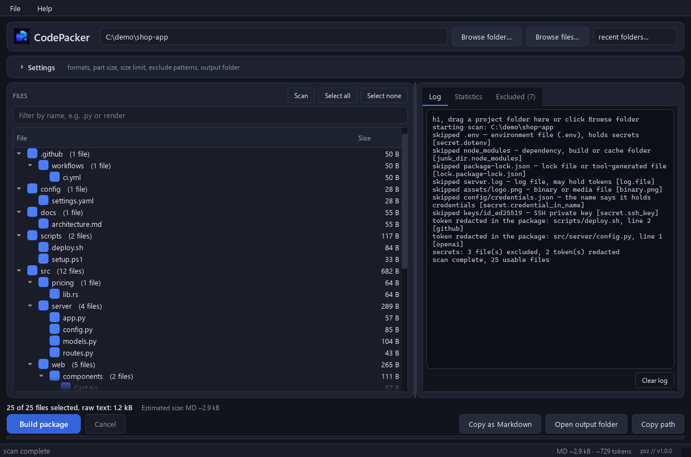
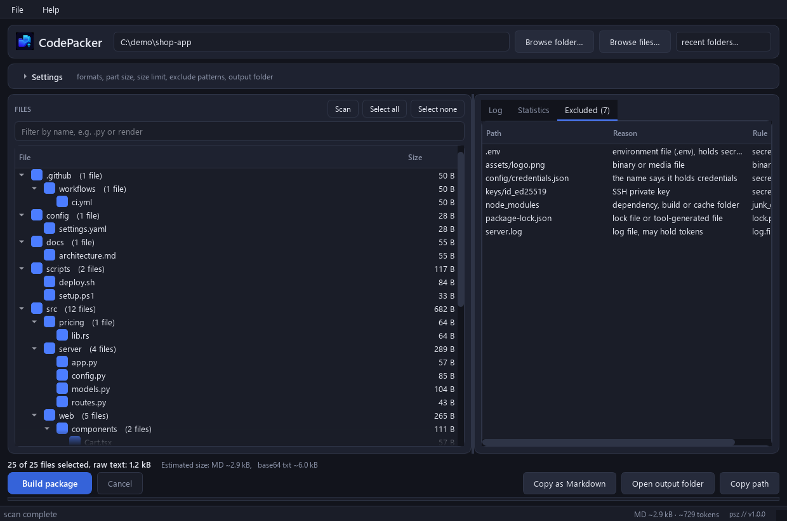
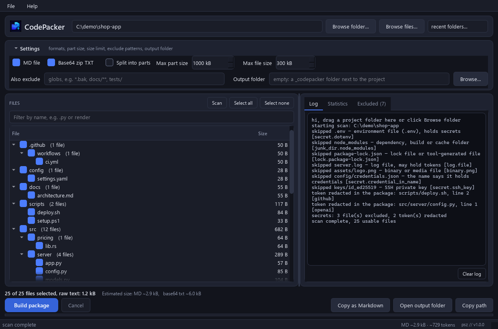
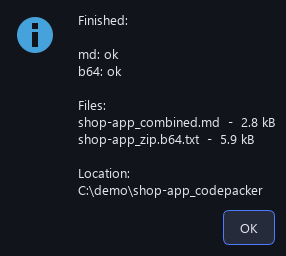
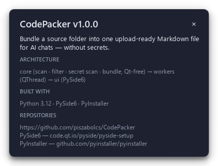
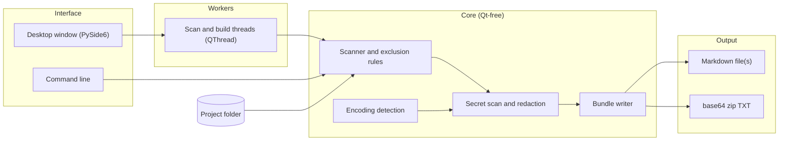

<div align="center">


# CodePacker

**Pack a source folder into one upload-ready Markdown file for AI chats, minus the secrets**


[Features](#features) · [Screenshots](#screenshots) · [Architecture](#architecture) · [Installation](#installation)

</div>

<p align="center">
  
</p>

## The problem

Many AI chats refuse zip uploads, so sharing a project means pasting it file by file. Copying a whole
folder by hand also drags along `.env` files, private keys, logs and `node_modules`, and a token buried
in a config file is easy to miss. Once it is in the chat, it is out of your hands.

## The solution

CodePacker walks the project, leaves out junk and secret files, replaces tokens it finds inside the
remaining files, and writes one Markdown file: the file tree plus every file in a fenced code block. As a
fallback it writes the project as a base64-encoded zip that a chat with a code sandbox can unpack. Every
file it leaves out is listed with its reason and rule, so nothing disappears silently, and your own files
are never changed.

## Features

- **Two output formats.** `<project>_combined.md` (recommended) and `<project>_zip.b64.txt` for chats with a code sandbox.
- **Secret files stay out.** `.env*`, SSH and TLS keys, keystores, cloud credentials, Terraform state and secret folders are a hard exclusion that cannot be checked back in.
- **Token redaction.** AWS, GitHub, Slack, Google, JWT and AI-provider API keys and secret-looking key/value pairs become `[REDACTED:<type>]` in the package.
- **Exclusions with reasons.** Every skipped file or folder appears in the log and the Excluded tab with its reason and the rule that matched.
- **Split by size.** The Markdown output can be split into parts under a size limit, never cutting a file in two.
- **Ad-hoc packages.** Drop a few files instead of a folder and get the same filtering, with paths relative to their common parent.
- **Copy as Markdown.** Puts the checked files on the clipboard and shows the size and a token estimate.
- **Command line.** `python -m codepacker` runs the Qt-free core for scripts and CI.

## Screenshots

<table>
  <tr>
    <td align="center" width="50%"><br/><sub>Every exclusion with its reason and rule</sub></td>
    <td align="center" width="50%"><br/><sub>Formats, part size, size limit, exclude globs, output folder</sub></td>
  </tr>
  <tr>
    <td align="center" width="50%"><br/><sub>Per-format build result</sub></td>
    <td align="center" width="50%"><br/><sub>About card</sub></td>
  </tr>
</table>

The screenshots are generated offscreen from a synthetic demo project by `tools/make_demo.py`; the paths
they show are masked to `C:\demo`.

## Architecture



`codepacker/core` holds all scanning, filtering, secret detection and bundle writing and never imports Qt,
so the command line runs without PySide6. The desktop window runs the same core in `QThread` workers, so
scans and builds can be cancelled and the window stays responsive. Files are read in their own encoding
(UTF-8, UTF-16/32 with or without BOM, cp1250, latin-1) before they reach the Markdown output.

## Tech stack

| Layer | Technology |
|---|---|
| Language | Python 3.11+ (tested with 3.12) |
| Desktop UI | PySide6 (Qt 6) |
| Background work | `QThread` workers |
| Core | Python standard library only (`zipfile`, `base64`, `re`, `fnmatch`) |
| Packaging | PyInstaller, single `CodePacker.exe` |
| Tests and CI | pytest, pytest-qt (offscreen), pip-audit, GitHub Actions on Windows |

## Installation

Prerequisites: Windows 10 or 11 and Python 3.11 or newer (the secret-scanner patterns use atomic groups
and possessive quantifiers).

1. Clone the repository:
   ```powershell
   git clone https://github.com/piszabolcs/codepacker.git
   cd codepacker
   ```
2. Create the virtual environment and install the runtime dependency:
   ```powershell
   py -3.12 -m venv .venv
   .venv\Scripts\python.exe -m pip install -r requirements.txt
   ```
3. Start the app (or double-click `run.bat`, which uses `.venv` when it exists):
   ```powershell
   .venv\Scripts\python.exe main.py
   ```
4. Optional, build the standalone exe (installs the pinned tools from `requirements-dev.txt` into `.venv`):
   ```powershell
   build.bat
   ```
   The result is `dist\CodePacker.exe`; `CodePacker.exe --version` prints the version and exits.
5. Optional, run the tests (offscreen, no window appears):
   ```powershell
   .venv\Scripts\python.exe -m pip install -r requirements-dev.txt
   .venv\Scripts\python.exe -m pytest -q
   ```

## Usage

1. Drop a project folder on the window, or click "Browse folder…" and press Enter to scan.
2. Check the file list and the Excluded tab, adjust the checked files if needed.
3. Press "Build package" (Ctrl+B). Without an output folder the package goes to `<project>_codepacker`
   next to the project.

Command line:

```powershell
python -m codepacker <path...> [--md] [--b64] [--max-part SIZE] [--out DIR] [--exclude GLOB...] [--quiet]
```

One folder is a project; files or several paths make an ad-hoc package. `--max-part` takes sizes such as
`500k` or `2M`. The exit code is 0 on success and 1 on any failure or read error.

Notes:

- Settings live in `%APPDATA%\CodePacker\settings.ini`; the app writes no registry key of its own
  (Qt's file dialogs remember their last folder under `HKCU\Software\QtProject`). File > "Clear recent
  folders" forgets the recent-folder list.
- Nothing is sent anywhere. The log names files and token types, never file contents or secret values.
- Known limits: a secret in a source file that is neither a known token format nor a key/value pair is
  packed; unquoted values with spaces are not redacted; `*.pem` is excluded even when it holds only public
  certificates. Review the package before you upload it.

## Project structure

```text
codepacker/
├── codepacker/           # application package
│   ├── core/             # scanner, rules, secret scan, encoding, bundle writer (Qt-free)
│   ├── ui/               # PySide6 window, file tree, theme, About card
│   ├── workers.py        # QThread wrappers for scan and build
│   ├── settings.py       # INI settings in %APPDATA%
│   └── __main__.py       # command line
├── tests/                # pytest suite, runs offscreen
├── tools/                # make_demo.py: demo project and screenshots
├── assets/               # app icon
├── docs/                 # logo and screenshots
├── .github/workflows/    # CI: tests and pip-audit on Windows
├── main.py               # desktop entry point
├── run.bat, build.bat    # start from source, build the exe
└── codepacker.spec       # PyInstaller spec
```

## Roadmap

- [ ] Recognise more lock files (`uv.lock`, `bun.lockb`, `packages.lock.json`).
- [ ] Redact unquoted secret values that contain spaces.
- [ ] Let public certificate bundles (`*.pem` without a private key) through on request.
- [ ] Publish `CodePacker.exe` as a GitHub Release.

## License

Apache License 2.0, see [LICENSE](LICENSE). The standalone exe bundles third-party software: Qt for Python
and the Qt 6 libraries (LGPL-3.0) and the PyInstaller bootloader (GPL-2.0-or-later with the bootloader
exception); the notices are in [NOTICE](NOTICE).

---

<div align="center">
<sub>Built by Szabolcs Pintér · <a href="https://github.com/piszabolcs">GitHub</a> · <a href="https://www.linkedin.com/in/piszabolcs">LinkedIn</a></sub>
</div>
